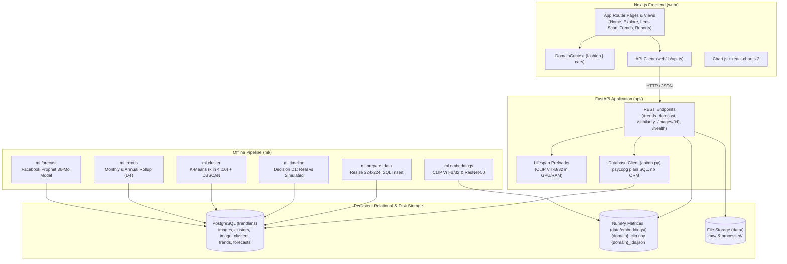
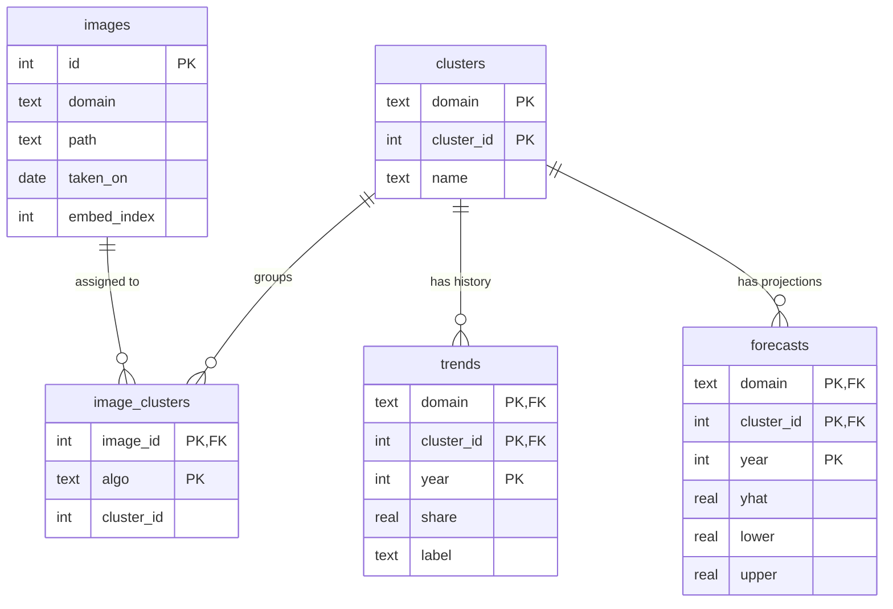
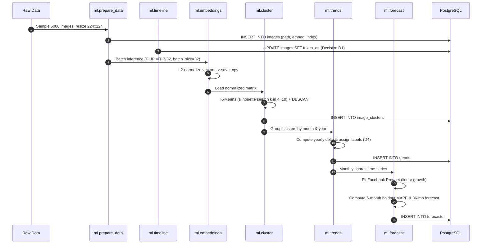

# TrendLens System Architecture & Data Flow

> **Document Version:** 1.0.0  
> **System:** TrendLens — Multi-Genre AI Visual Trend Analysis & Forecasting  
> **Target Evaluation:** BS Computer Science Final Year Project  
> **AST Dependency Graph:** 258 Nodes, 775 Edges, 9 Communities (via Graphify)  

---

## 1. High-Level Architecture Overview

TrendLens operates on a decoupled client-server architecture designed for high-throughput image embedding extraction, unsupervised visual clustering, temporal share tracking, time-series forecasting, and sub-second cosine similarity search.

---

## 2. Frontend Architecture (`web/`)

The frontend is constructed using the modern Next.js App Router with TypeScript and pure CSS custom properties.

### 2.1 Framework & Core Libraries
- **Framework:** Next.js 16 (App Router, React 19).
- **Language:** TypeScript 5.x / 7.x strictly typed without `any` bypasses in core models.
- **Styling Architecture:** Pure CSS design tokens (`web/app/globals.css`) implementing the Dark Luxury Slate & Gold system (`#222831`, `#393E46`, `#FFD369`, `#EEEEEE`). No external utility frameworks (Tailwind prohibited by AGENTS.md locked stack).
- **Visualization:** `chart.js` with `react-chartjs-2` for historical time-series curves and Prophet confidence intervals.
- **Routing Strategy:** Static and server-rendered editorial pages:
  - `/` &mdash; Home editorial view with hero section, trending visuals, and interactive overview curve.
  - `/explore` &mdash; Visual cluster explorer with grid controls and metadata filter.
  - `/lens-scan` &mdash; Image upload dropzone, benchmark sample presets, and top-3 cosine similarity matching.
  - `/trends` &mdash; Detailed multi-year trajectory analytics, Prophet projection curves, and accessible data tables.
  - `/reports` &mdash; Executive cross-domain comparative report with client-side CSV rollups.
  - `/settings` &mdash; Domain preferences and system architecture health status.
  - `/about` &mdash; Full academic methodology disclosure, timeline rationale (D1), and dataset citations.
  - `/[domain]/[clusterId]` &mdash; *(Incomplete / Target Route)* Deep-dive single-cluster report.

### 2.2 Global State Architecture
Client-side state is centralized within [`web/lib/DomainContext.tsx`](file:///c:/Users/XashuraX/OneDrive%20-%20Higher%20Education%20Commission/Desktop/HxSageterrius/BSCS_7th_Semester/FYP%20Project/Trend-Lens/web/lib/DomainContext.tsx):
- `domain`: `'fashion' | 'cars'` &mdash; Persisted in `localStorage('trendlens_domain')`.
- `systemStatus`: `{ online: boolean, mode: 'live' | 'mock' }` &mdash; Initialized via `GET /health`.
- `searchQuery`: Global string synchronized between top header `⌘K` search and the Explore filtering grid.

---

## 3. Backend Architecture (`api/`)

The backend is built with FastAPI and runs on Uvicorn, strictly enforcing the API contract defined in AGENTS.md Section 6.

### 3.1 Startup & In-Memory Model Preloading
In `live` mode, the API preloads the heavy deep learning artifacts into memory during the application lifespan (`@asynccontextmanager` in `api/main.py`):
1. **CLIP Feature Extractor:** Loads `openai/clip-vit-base-patch32` weights and tokenizer once into GPU/RAM.
2. **Similarity Search Engines:** Instantiates `SimilaritySearchEngine` for `fashion` and `cars`, preloading the L2-normalized `.npy` embedding matrices and corresponding database IDs from disk.
3. This eliminates model instantiation latency during image upload requests, allowing `/similarity` responses within 150–350ms.

### 3.2 Endpoints & Handlers

| Method | Route | Parameter | Handler Function | Response Structure |
|---|---|---|---|---|
| `GET` | `/health` | None | `health()` | `{"status": "ok", "mode": "live"}` |
| `GET` | `/trends` | `domain=fashion\|cars` | `trends(domain)` | `{domain, years, mode, timeline, clusters: [{cluster_id, name, label, share}]}` |
| `GET` | `/forecast` | `domain=`, `cluster_id=` | `forecast(domain, cluster_id)` | `{domain, cluster_id, name, label, timeline, history, forecast, sample_images}` |
| `POST` | `/similarity` | `domain=`, `file: UploadFile` | `similarity(domain, file)` | `{"matches": [{cluster_id, name, label, score}]}` |
| `GET` | `/images/{id}`| `image_id: int` | `serve_image(image_id)` | Serves binary image (`image/jpeg`) from local disk via database path lookup. |

---

## 4. Database Schema & Storage Architecture

PostgreSQL stores metadata, cluster assignments, historical adoption shares, and forecast points. Embeddings are stored externally in NumPy binary files to prevent database bloat and comply with the prohibition of pgvector/FAISS.

### 4.1 SQL Schema Details (`api/schema.sql`)
1. **`images` Table:** Tracks each image's file path, domain, capture date (`taken_on`), and row index (`embed_index`) into the `.npy` matrix.
2. **`clusters` Table:** Primary key `(domain, cluster_id)`. Stores human-readable names assigned during contact sheet inspection.
3. **`image_clusters` Table:** Stores cluster assignments for both `kmeans` and `dbscan` (`cluster_id = -1` flags DBSCAN noise).
4. **`trends` Table:** Yearly aggregated share percentages and D4 trajectory labels (*emerging*, *declining*, *stable*).
5. **`forecasts` Table:** Annual rollup of Prophet projections (`yhat`) and 80% confidence interval bounds (`lower`, `upper`).

### 4.2 Embedding Matrix Layout (`data/embeddings/`)
- `fashion_clip.npy`: Matrix of shape $(N, 512)$ of float32 L2-normalized embeddings.
- `cars_clip.npy`: Matrix of shape $(M, 512)$ of float32 L2-normalized embeddings.
- `fashion_ids.json` / `cars_ids.json`: Sequential mapping array aligning `.npy` row indices with PostgreSQL `images.id`.

---

## 5. Machine Learning Pipeline Architecture (`ml/`)

The pipeline runs sequentially or by stage using the CLI entrypoint:
`python -m ml.run_pipeline --domain [fashion|cars] --stage [prepare|timeline|embed|cluster|trends|forecast]`

### 5.1 Architectural Decisions Implemented
- **Decision D1 (Temporal Axis):**
  - *Fashion:* DeepFashion2 lacks capture timestamps. Deterministically distributed across 2021–2025 using a stable seeded process independent of cluster identity. Disclosed everywhere as `timeline: "simulated"`.
  - *Cars:* Stanford Cars parses trailing 4-digit model years from class directory names (e.g., "Acura RL Sedan 2012" &rarr; `2012`). Marked as `timeline: "real"`.
- **Decision D4 (Trend Labeling):**
  - $\Delta = \text{Share}_{\text{final\_year}} - \text{Share}_{\text{initial\_year}}$ (percentage points).
  - If $\Delta > +5.0\%$ &rarr; **Emerging**.
  - If $\Delta < -5.0\%$ &rarr; **Declining**.
  - Otherwise &rarr; **Stable**.
- **Decision D5 (DBSCAN Role):**
  - Trends and forecasts are computed strictly on K-Means clusters.
  - DBSCAN is executed with cosine distance to detect noise images ($\text{cluster\_id} = -1$) and measure latent density.

---

## 6. Graphify Dependency Analysis

Based on the automated Abstract Syntax Tree (AST) extraction generated by Graphify:
- **Total Architectural Nodes:** 258
- **Total Cross-Module Edges:** 775
- **Identified Core Communities:**
  1. `ml.embeddings` &harr; `transformers.CLIPModel` / `torchvision.models.resnet50`
  2. `ml.cluster` &harr; `sklearn.cluster.KMeans` / `sklearn.metrics.silhouette_score`
  3. `ml.forecast` &harr; `prophet.Prophet`
  4. `api.main` &harr; `api.db` &harr; `psycopg.connect`
  5. `api.main` &harr; `ml.similarity.SimilaritySearchEngine`
  6. `web.lib.DomainContext` &harr; `web.components.Sidebar` / `web.components.Header`
  7. `web.app.trends` &harr; `web.components.ui.Table` / `web.components.ui.Popover`
  8. `web.components.HomeEditorialView` &harr; `web.lib.api.getJSON`
  9. `web.app.sitemap` &harr; `web.lib.api.DOMAINS`

The modular isolation between `ml/` (data generation), `api/` (serving), and `web/` (presentation) ensures that changes to the visual design do not impact machine learning reproducibility or database integrity.
