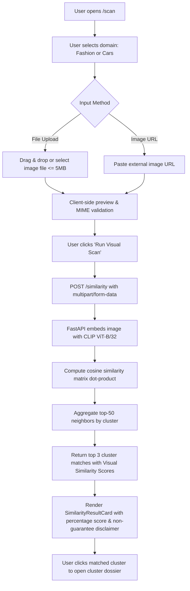
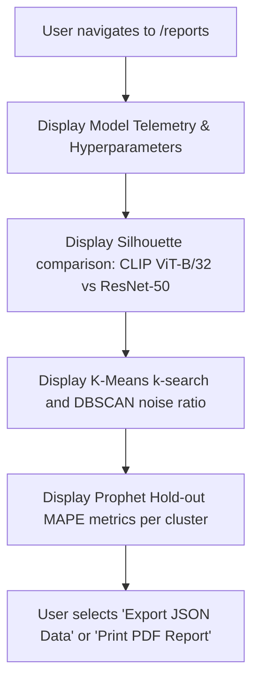

# TrendLens User Flows & Interaction Workflows

> **Status:** Phase 3.1 Architecture Validation & Refinement  
> **Theme:** Light Minimalist Editorial & Visual Analytics  

---

## 1. Flow 1: Visual Trend Discovery & Forecasting Exploration

```mermaid
flowchart TD
    A[User lands on Home Page] --> B{Choose Domain}
    B -->|Fashion| C1[Set domain = 'fashion']
    B -->|Automobiles| C2[Set domain = 'cars']
    C1 --> D[Fetch /trends?domain=fashion]
    C2 --> D[Fetch /trends?domain=cars]
    D --> E[Display KPI Cards & Trending Lookbook]
    E --> F[User clicks 'Explore Trends']
    F --> G[Navigate to /trends]
    G --> H[Render HistoryForecastChart with solid historical & dashed Prophet curve]
    H --> I[User clicks specific cluster e.g., Style 1]
    I --> J[Navigate to /[domain]/[clusterId]]
    J --> K[Render 12-image contact sheet & single-cluster MAPE / 36-mo forecast]
```

---

## 2. Flow 2: Google Lens-Style Visual Similarity Search (`/scan`)



---

## 3. Flow 3: Academic Evaluation & Report Export (`/reports`)


